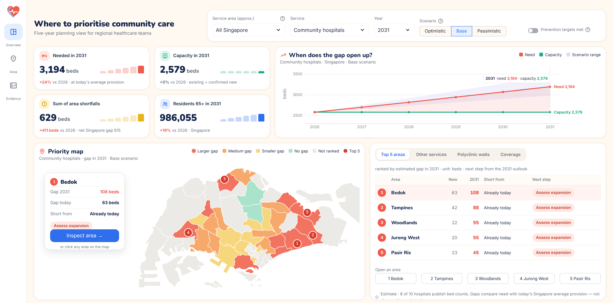

# HealthPulse — where, which service and from when

**Team PulseForward · DAISI Challenge Singapore 2026 · Track A3 (community healthcare demand forecasting)**

Singapore's residents aged 65+ grow from about 829,000 (2026) to 986,000 (2031). HealthPulse shows regional health planners **which planning areas** will fall short of community care, **in which service**, and **from when**, and lets them record what they decide.



## What it does

Each service keeps its own unit, and services are never added together:

| Service | Measure |
|---|---|
| Community hospitals | beds needed vs beds residents can reach |
| Nursing homes | beds needed vs beds residents can reach |
| Day care & rehabilitation | places needed vs places residents can reach |
| Primary care | seniors living more than 1 km from a polyclinic or CHAS GP |

**Databricks App, three views:**

- **Overview — where to prioritise.**
  - A priority map with the Top 5 areas numbered.
  - Need vs capacity from 2026 to 2031.
  - For each Top 5 area: the gap now and in the chosen year, the year the shortfall starts, and a suggested next step.
  - A cross-service view of areas that rank high in several services.
- **Area — what to do here.**
  - All four services side by side, nearby and announced facilities, and polyclinic waiting times.
  - A decision panel that writes status, owner and note to Lakebase.
- **Evidence.**
  - Why the tool exists, the method in plain words, and what the data cannot show.
  - The checks we ran, the assumptions and the sources.

The same Gold tables feed an **AI/BI dashboard** (with a cluster filter) and a **Genie** space.

Controls:

- **Scenarios:** optimistic, base or pessimistic ageing, with project delays in the pessimistic case.
- **"Prevention targets met":** an illustrative 10% drop in use by people aged 65+. This is our assumption, not an official target.

## Architecture (Databricks Free Edition)

```
SingStat · MOH · AIC · URA · OneMap files ─► UC Volume ─┐
data.gov.sg datastore API (live)                       ─┴─► Lakeflow Job "HealthPulse_pipeline" (5 serverless tasks, ~8 min)
   01 Bronze ingest → 02 Silver + data-quality rules → 03 Forecast + MLflow → 04 Service planning → 05 Governance
Gold Delta tables (Unity Catalog: lineage, tags, comments, cluster row filter, small-cell column mask)
   ├─► Databricks App (Streamlit, service principal via SQL warehouse) ◄─► Lakebase Postgres (planning decisions)
   ├─► AI/BI dashboard
   └─► Genie space
```

## Method

1. **Population to 2031.** We forecast by planning area × sex × 5-year age group with a cohort-component model. People age, survive at SingStat life-table rates, and each area keeps its 2022–2025 migration pattern.
   - Rolling backtest from five start years (2016–2020): the cohort model has the lowest error every time, 1.8–2.2% for residents aged 65+.
   - The ageing scenarios shift 65+ migration in one direction only. Slower ≤ base ≤ faster holds for all 275 area-years.
2. **Need at today's Singapore-average provision.**
   - Community-hospital beds follow expected admissions, using MOH 2025 age-sex rates.
   - Nursing-home beds and day-care places follow residents aged 75+.
3. **Reachable capacity.** A two-step floating catchment shares every bed or place among the residents who can reach it. The shares add back exactly to national capacity (2,579 / 21,056 / 9,400).
4. **Priority.** Areas are ranked per service.
   - The Top 5 is tested across three scenarios, and in 200 draws that vary population and estimated capacities together.
   - Next steps are cautious, for example "Assess expansion" or "Verify current capacity", and each comes with a one-line reason.
   - Totals are sums of each area's shortfall; the net national gap is shown for reference.

## Repository

| Path | Content |
|---|---|
| `src/hp_core.py`, `src/hp_services.py`, `src/hp_pipeline.py` | All model logic (pandas); runs locally and on Databricks |
| `notebooks/01_bronze_ingest.py` … `05_governance.py` | Lakeflow Job tasks |
| `app/` | Databricks App: `app.py` (UI), `backend.py` (Unity Catalog reads + Lakebase write-back), `app.yaml` |
| `dashboard/` | AI/BI dashboard builder and JSON |
| `genie/` | Genie space builder and JSON |
| `data_prep/` | Small derived inputs: boundary overlap, polyclinic waits, polyclinics opened after the source list |
| `screenshots/` | App screenshots |

### Run it

1. Upload the public source files to the Volume `workspace.healthpulse_bronze.raw_files`, then run the job `HealthPulse_pipeline` (tasks 01→05).
2. Deploy `app/` as a Databricks App with two resources:
   - a SQL warehouse (`sql-warehouse`);
   - optionally, a Lakebase database (`postgres`) for decision write-back.
3. **Local preview without Databricks:** set `HP_MOCK_DIR` to a folder of Gold parquet exports, then run `streamlit run app/app.py`.

## Limitations

- Gaps are estimates against today's Singapore-average provision, not observed unmet need. No public area-level waiting-list or patient-flow data exists.
- Nursing-home beds are published for 3 of 94 homes, and day-care places only as a national total; the rest are shared and stress-tested.
- Announced projects without a year count only in the optimistic scenario.
- Cluster membership is approximated by the cluster of the nearest polyclinic.
- Distances are straight-line, and the CHAS clinic list is a 2021 snapshot.

## Data sources and credits

**Data:**

- SingStat: residents by planning area, subzone, age and sex (2011–2026), and life tables.
- MOH: admission rates by age and sex (2025); beds and day places (2025); polyclinic waiting times (Aug 2026); upcoming facilities.
- data.gov.sg: monthly community-hospital admissions (API).
- AIC eldercare directory; CHAS clinics (2021); URA Master Plan boundaries; OneMap geocoding.

**Software:**

- Libraries: pandas, NumPy, MLflow, Streamlit, Plotly, Shapely, psycopg.
- Built on Databricks Free Edition. Claude (Anthropic) was used as an AI coding assistant.
